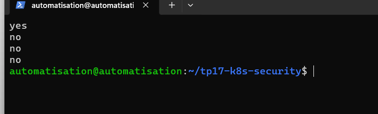
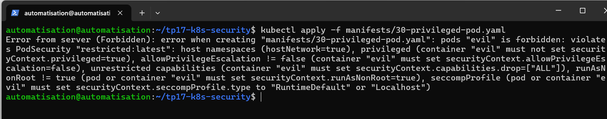
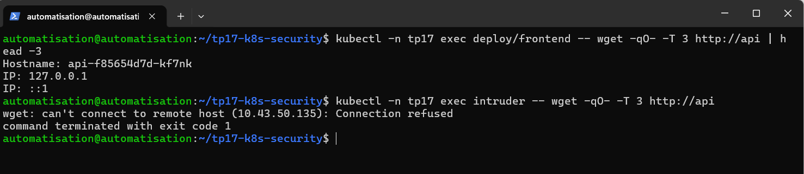

# TP17 : Sécurité Kubernetes (RBAC, Pod Security, NetworkPolicy, Kyverno, Falco)

Défense en profondeur appliquée à une application volontairement mal configurée : RBAC, durcissement des Pods, Pod Security Standards, NetworkPolicies, Policy as Code (Kyverno), puis analyse continue (Trivy Operator, Kubescape) et détection à l'exécution (Falco).
Les réponses aux questions sont dans [REPONSES.md](REPONSES.md).

```
.
├── captures/
├── manifests/
│   ├── 00-app.yaml               ← application de départ (latest, privileged, root, pas de limits) + Pod intruder
│   ├── 01-app-hardened.yaml      ← api et frontend durcis (restricted)
│   ├── 10-rbac.yaml              ← ServiceAccount api-sa, Role configmap-reader, RoleBinding
│   ├── 20-networkpolicies.yaml   ← default deny + DNS + frontend → api:8080
│   ├── 30-privileged-pod.yaml    ← Pod privilégié (doit être refusé)
│   └── 90-bad-deployment.yaml    ← Deployment non conforme (test Kyverno Enforce)
├── policies/                     ← 4 ClusterPolicies Kyverno (Audit) + TODO-policies.md
├── values-falco.yaml             ← Falco modern_ebpf sur K3s
└── defi/
    ├── mutate-seccomp.yaml       ← mutation Kyverno : seccompProfile RuntimeDefault
    └── gatekeeper/               ← règle "pas de latest" en Rego
```

> **Version de Kyverno** : depuis **Kyverno 1.20**, les `ClusterPolicy` (`kyverno.io/v1`) ne sont plus exécutées (migration vers `ValidatingPolicy` en CEL). Le TP utilise des `ClusterPolicy` : on installe donc **Kyverno 1.19.2** (chart `3.9.2`), dernière version qui les applique encore.

## 0. Préparation

Le cluster K3s a 5 Go de RAM : Kyverno, Trivy Operator et Falco en demandent beaucoup. Libérer Keycloak et le TP16 **après les avoir poussés sur GitHub** :

```bash
kubectl delete ns tp16 keycloak --ignore-not-found
free -m
kubectl apply -f manifests/00-app.yaml
kubectl -n tp17 get pods            # tout est accepté, sans aucun avertissement
```

## 1. Partie 1 : RBAC et ServiceAccount

```bash
kubectl auth can-i --list --as=system:serviceaccount:tp17:default -n tp17

kubectl apply -f manifests/10-rbac.yaml
SA=system:serviceaccount:tp17:api-sa
clear
kubectl auth can-i get configmaps   --as=$SA -n tp17     # yes
kubectl auth can-i list secrets     --as=$SA -n tp17     # no
kubectl auth can-i get configmaps   --as=$SA -n default  # no
kubectl auth can-i create pods      --as=$SA -n tp17     # no
```

**Capture `rbac-can-i.png`** : les 4 réponses `yes` / `no` / `no` / `no`.

```bash
kubectl get clusterrolebindings -o wide | grep cluster-admin
```

## 2. Partie 2 : securityContext

```bash
kubectl apply -f manifests/01-app-hardened.yaml
kubectl -n tp17 rollout status deploy/api && kubectl -n tp17 rollout status deploy/frontend
kubectl -n tp17 exec deploy/frontend -- id                   # uid=101(nginx)
kubectl -n tp17 exec deploy/frontend -- touch /etc/test      # Read-only file system
kubectl -n tp17 exec deploy/frontend -- touch /tmp/test && echo "/tmp inscriptible (emptyDir)"
kubectl -n tp17 get deploy api -o jsonpath='{.spec.template.spec.serviceAccountName}{"\n"}'
```

## 3. Partie 3 : Pod Security Standards

```bash
kubectl label ns tp17 pod-security.kubernetes.io/warn=restricted \
  pod-security.kubernetes.io/audit=restricted --overwrite
kubectl -n tp17 rollout restart deploy           # aucun avertissement : les Deployments sont conformes

kubectl label ns tp17 pod-security.kubernetes.io/enforce=restricted --overwrite
# Avertissement attendu : le Pod "intruder" existant viole le profil (il n'est pas supprimé).
clear
kubectl apply -f manifests/30-privileged-pod.yaml
```

**Capture `pss-denied.png`** : `Error from server (Forbidden): … violates PodSecurity "restricted:latest": host namespaces, privileged, allowPrivilegeEscalation…`.

> Ne supprimez pas le Pod `intruder` : il ne pourrait plus être recréé dans `tp17`, et il sert aux Parties 4 et 6.

## 4. Partie 4 : NetworkPolicies

```bash
kubectl -n tp17 exec intruder -- wget -qO- -T 3 http://api | head -3        # avant : OK

kubectl apply -f manifests/20-networkpolicies.yaml
kubectl -n tp17 get networkpolicy
clear
kubectl -n tp17 exec deploy/frontend -- wget -qO- -T 3 http://api | head -3   # OK (Hostname: api-…)
kubectl -n tp17 exec intruder        -- wget -qO- -T 3 http://api             # timeout
```

**Capture `netpol.png`** : réponse de l'api depuis le frontend, puis `wget: download timed out` pour l'intrus.

Pour observer le « default deny » seul (même le DNS est coupé), appliquer d'abord uniquement la première policy :
`kubectl apply -f <(sed -n '1,/^---/p' manifests/20-networkpolicies.yaml)` puis `kubectl -n tp17 exec deploy/frontend -- nslookup api` → échec.

## 5. Partie 5 : Kyverno

```bash
helm repo add kyverno https://kyverno.github.io/kyverno/ && helm repo update
helm install kyverno kyverno/kyverno -n kyverno --create-namespace --version 3.9.2
kubectl -n kyverno get pods                       # 4 contrôleurs Running

kubectl apply -f policies/
kubectl get clusterpolicy                         # READY True
kubectl -n tp17 rollout restart deploy            # nouveaux Pods évalués
sleep 30
kubectl get policyreports -A
kubectl get policyreport -n tp17 -o yaml | grep -B2 -A6 fail
```

Tests hors cluster avec la CLI (même version que le contrôleur) :

```bash
clear
docker run --rm -v "$PWD:/w" ghcr.io/kyverno/kyverno-cli:v1.19.2 apply /w/policies/ --resource /w/manifests/00-app.yaml
docker run --rm -v "$PWD:/w" ghcr.io/kyverno/kyverno-cli:v1.19.2 apply /w/policies/ --resource /w/manifests/01-app-hardened.yaml
```

**Capture `kyverno-cli.png`** : `pass: 7, fail: 8` pour l'application de départ, puis `fail: 0` pour l'application durcie.

Passage en Enforce :

```bash
sed -i 's/failureAction: Audit/failureAction: Enforce/' policies/*.yaml
kubectl apply -f policies/
clear
kubectl apply -f manifests/90-bad-deployment.yaml
```

**Capture `kyverno-enforce.png`** : `admission webhook "validate.kyverno.svc-fail" denied the request` avec les messages des policies (tag latest, privilégié, runAsNonRoot, requests/limits).

## 6. Partie 6 : Trivy Operator, Kubescape, Falco

```bash
helm repo add aqua https://aquasecurity.github.io/helm-charts/ && helm repo update
helm install trivy-operator aqua/trivy-operator -n trivy-system --create-namespace \
  --set targetNamespaces=tp17 --set operator.scanJobsConcurrentLimit=1
# Attendre 3 à 5 minutes (téléchargement de la base de vulnérabilités)
kubectl get vulnerabilityreports -n tp17 -o wide
kubectl get configauditreports -n tp17 -o wide
```

Kubescape, score avant / après :

```bash
curl -s https://raw.githubusercontent.com/kubescape/kubescape/master/install.sh | /bin/bash
export PATH=$PATH:$HOME/.kubescape/bin
kubescape scan framework nsa manifests/00-app.yaml          # avant durcissement
kubescape scan framework nsa manifests/01-app-hardened.yaml manifests/10-rbac.yaml manifests/20-networkpolicies.yaml   # après
kubescape scan framework nsa --include-namespaces tp17      # cluster
```

**Capture `trivy-kubescape.png`** : rapports Trivy (`CRITICAL`, `HIGH`…) et les deux scores Kubescape (avant / après). Plusieurs captures si besoin.

Falco :

```bash
helm repo add falcosecurity https://falcosecurity.github.io/charts && helm repo update
helm install falco falcosecurity/falco -n falco --create-namespace -f values-falco.yaml
kubectl -n falco rollout status ds/falco --timeout=300s

kubectl -n tp17 exec -it intruder -- sh -c 'cat /etc/shadow; nc -l -p 4444 & sleep 1'
sleep 5
clear
kubectl -n falco logs -l app.kubernetes.io/name=falco -c falco --tail=200 | grep -E 'Notice|Warning|Critical'
```

**Capture `falco-alert.png`** : `Warning Sensitive file opened for reading by non-trusted program (file=/etc/shadow … k8s_pod_name=intruder k8s_ns_name=tp17)`.

## 7. Défis

* Mutation : `kubectl apply -f defi/mutate-seccomp.yaml`, puis créer un Pod sans seccomp dans `tp17` et vérifier `kubectl get pod … -o jsonpath='{.spec.securityContext}'`.
* Gatekeeper : voir `defi/gatekeeper/README.md`.

## 8. Nettoyage

```bash
helm uninstall falco -n falco; helm uninstall trivy-operator -n trivy-system; helm uninstall kyverno -n kyverno
kubectl delete clusterpolicy --all
kubectl delete ns tp17 falco trivy-system kyverno
```

## Captures

**rbac-can-i**



**pss-denied**



**netpol**


